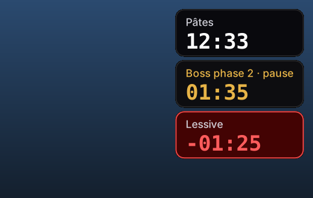

# decky-timer – plugin Decky Loader

Des timers nommés pour le Steam Deck, affichés **en overlay par-dessus le jeu**.



## Fonctionnalités

- **Timers enregistrés** : donne un nom et une durée à un timer, il devient un bouton dans le menu. Un appui le relance, sans liste déroulante.
- **Timers ponctuels** : lance un timer sans l'enregistrer.
- **Plusieurs timers en même temps**, empilés dans l'overlay.
- **Temps dépassé** : à zéro, le timer continue en négatif (en rouge) et une notification s'affiche.
- **Contrôle** : touche un timer en cours dans le menu pour le mettre en pause, le reprendre, le relancer ou l'arrêter.
- **Raccourci manette** : maintiens une combinaison en jeu (L5 + R5 par défaut, ou L4 + R4, Select + Start) pour ouvrir directement le menu pause / relancer / arrêter. S'il y a plusieurs timers, une liste triée par urgence s'affiche. Comme decky-macro, la manette est lue directement (hidraw), donc ça marche en jeu, et le plugin tourne en root pour y accéder (l'overlay, lui, tourne sous l'utilisateur normal). Toucher l'overlay lui-même n'est pas possible : gamescope envoie le tactile au jeu.
- **Overlay réglable** : position (coins / haut centre), taille, opacité du fond, on/off.
- **Mise à jour intégrée** : le plugin vérifie la dernière release GitHub et l'installe via l'installeur de Decky. Plus besoin de retaper l'URL.

## Installation

1. Dans Decky : *Paramètres → Développeur*, active le mode développeur.
2. *Installer un plugin depuis une URL* :
   ```
   https://github.com/powange/decky-timer/releases/latest/download/decky-timer.zip
   ```
3. Ensuite, les mises à jour se font avec le bouton **Mises à jour** en bas du plugin.

## Comment marche l'overlay

Decky n'affiche normalement rien pendant une partie, en dehors du menu d'accès rapide. Le backend lance donc un petit processus (`overlay/overlay.py`, avec le `python3` du système) qui ouvre une fenêtre X11 transparente sur l'Xwayland de gamescope (`DISPLAY=:0`). Cette fenêtre porte l'atome `GAMESCOPE_EXTERNAL_OVERLAY`, comme mangoapp (l'overlay de performances) : gamescope l'affiche alors au-dessus du jeu. La fenêtre n'a pas de zone de saisie, donc elle n'intercepte jamais les touches ni l'écran tactile.

Le dessin se fait avec cairo via `ctypes`. `libX11`, `libXext` et `libcairo` sont déjà présents sur SteamOS, donc il n'y a rien à compiler. Le processus ne tourne que lorsqu'au moins un timer est actif.

## Dépannage

- Si l'overlay n'apparaît pas, une erreur s'affiche dans la section *Overlay en jeu*. Les détails sont dans `~/homebrew/logs/Decky Timer/overlay.log`.
- L'affichage X utilisé est `:0` par défaut. Il peut être changé dans `~/homebrew/settings/Decky Timer/state.json` (clé `display`).

## Développement

```bash
pnpm install
pnpm run build        # dist/index.js
pnpm run package      # target/decky-timer/
```

Pour publier une release, augmente `version` dans `package.json` et pousse sur `main`. Le workflow `release.yml` construit le zip et crée la release `v<version>`.

## Licence

BSD-3-Clause
